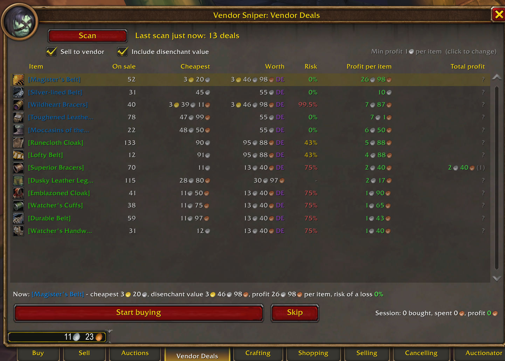
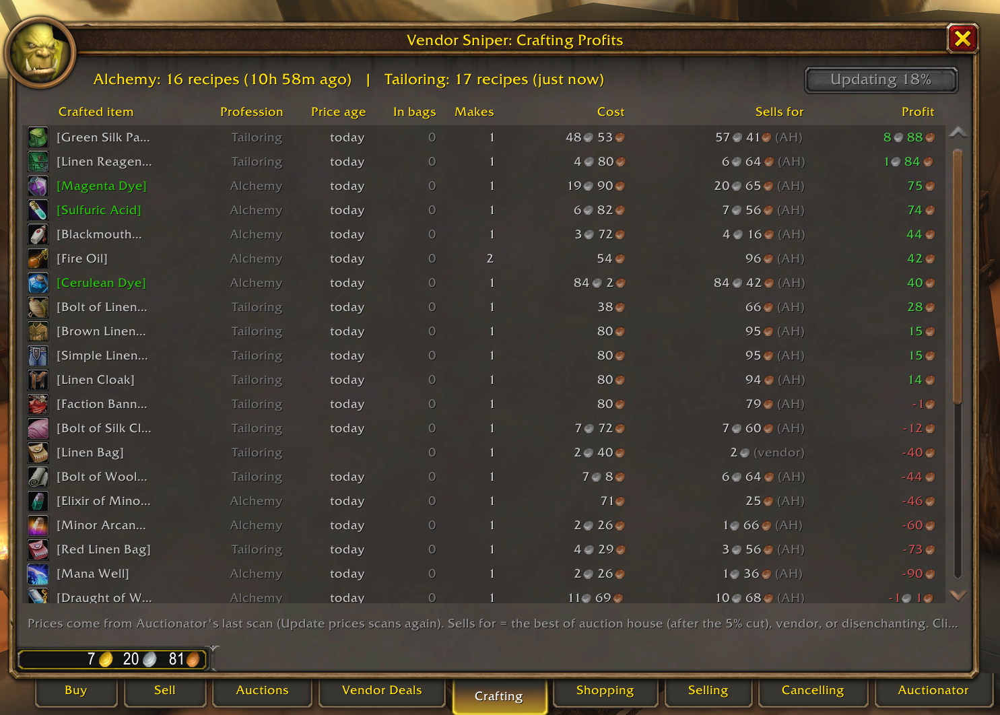
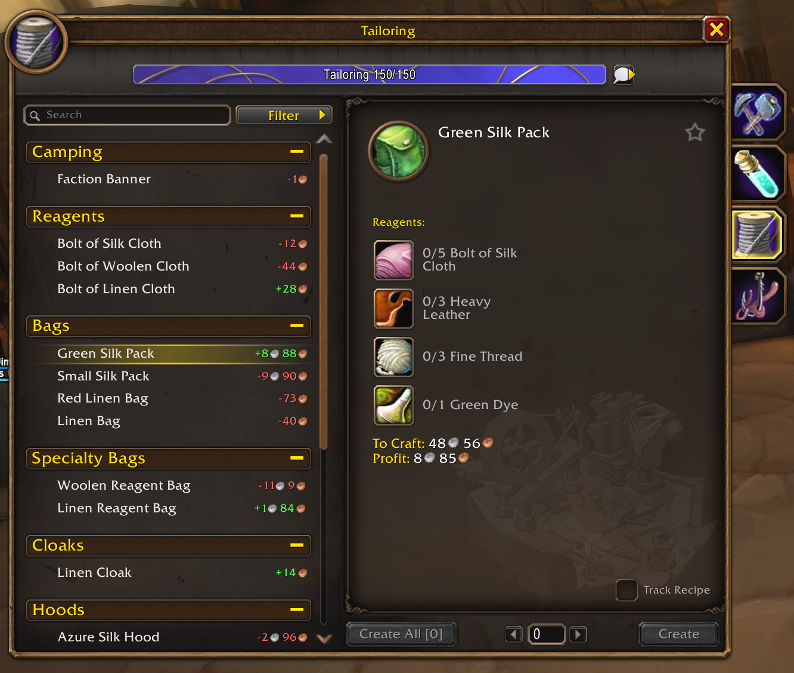
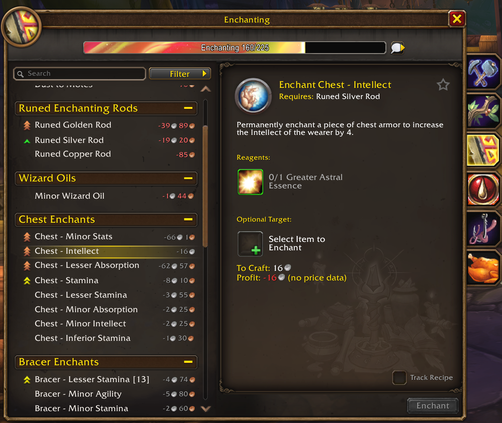
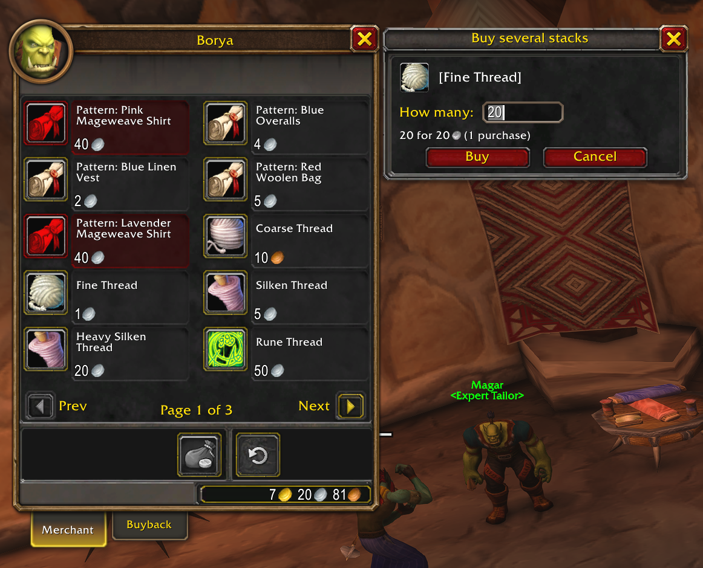
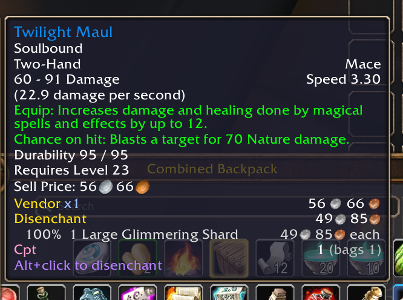
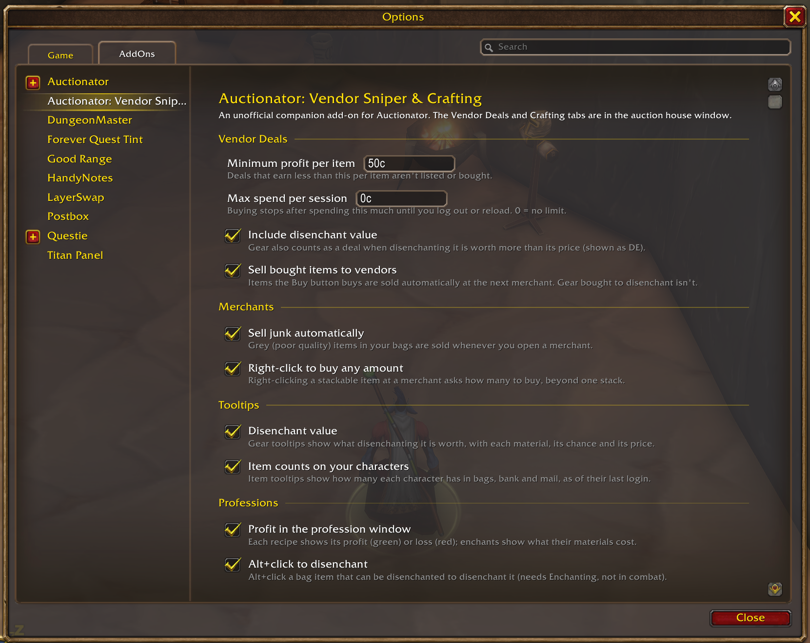

# Auctionator: Vendor Sniper & Crafting

An unofficial companion add-on for [Auctionator](https://www.curseforge.com/wow/addons/auctionator) on **WoW Forever**. It finds auctions you can resell to a vendor for a profit, shows which of your crafts make money, and handles the merchant chores around them. **Auctionator is required.**

**Highly customisable:** most features can be turned on or off in the options, so you only get the parts you want.

## Vendor Deals

A new tab in the auction house that lists every auction selling for less than a vendor will pay for it.

- **Scan** runs a quick summary scan of the whole auction house. It's Auctionator's own scan, so Auctionator's prices update at the same time, and scans started from Auctionator's button fill this list too.
- Deals are sorted by profit, with how much each item earns and the total for every unit on sale.
- **Buy** buys the selected deal. It checks the live price again first, so you never pay more than the item is worth. The game allows one purchase per click.
- **Include disenchant value**: gear also counts as a deal when its disenchant materials are worth more than its price (shown as "DE").
- **Disenchant risk**: most gear disenchants into dust most of the time, and the rarer essences and shards make up its average value. The **Risk** column shows how often disenchanting one item is worth less than you paid. Hover a deal to see every possible result and the risk when you buy several, which evens out the luck. Set a **max risk** to skip the gambles.
- **Sell to vendor**: what you buy is sold automatically the next time you talk to a merchant. Only the units you bought are sold, never copies you already had.
- Set a minimum profit per item (click it on the tab) and an optional spending cap per session.

## Crafting

A second auction house tab listing your recipes by profit: material cost (from the auction house or a vendor, whichever is cheaper) against what the crafted item sells for.

- **Update prices** searches every product and material again.
- Clicking a recipe searches the crafted item and its materials in Auctionator's Shopping tab.
- Recipes are learned when you open a profession window.
- In the profession window itself, every recipe shows its profit (green) or loss (red). Enchants show what their materials cost.

## Merchants

- **Sell junk automatically**: grey items are sold as soon as you open a merchant (off by default).
- **Buy any amount**: right-click a stackable item at a merchant to buy several stacks at once. The amount is capped by your money and bag space.

## Tooltips

- **Disenchant value** of gear, with each material, its chance and its auction price.
- **Item counts on your characters**: how many each of your characters has in bags, bank and mail.

## Disenchanting

Hold **Alt** and click a bag item to disenchant it (needs Enchanting).

## Options

Everything can be changed in **Options > AddOns > Auctionator: Vendor Sniper & Crafting**, or with `/vsnipe options`. Type `/vsnipe` for the chat commands.

---

This add-on is not affiliated with or endorsed by the authors of Auctionator. All Rights Reserved.
